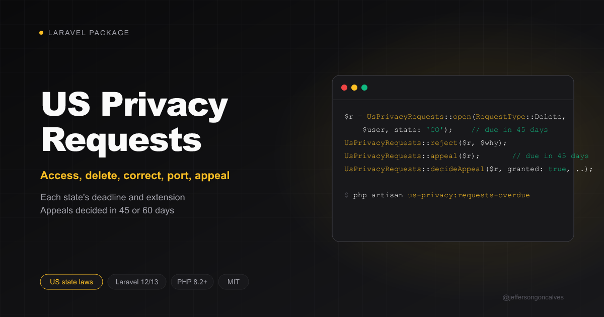

# Laravel US Privacy Requests



[](https://packagist.org/packages/jeffersongoncalves/laravel-us-privacy-requests)
[](https://github.com/jeffersongoncalves/laravel-us-privacy-requests/actions/workflows/tests.yml)
[](https://packagist.org/packages/jeffersongoncalves/laravel-us-privacy-requests)

Consumer requests under the US state privacy laws, on top of [laravel-us-privacy](https://github.com/jeffersongoncalves/laravel-us-privacy): access, correction, deletion and portability, answered within the deadline of the consumer's state, and the **appeal process** every state but Utah requires.

| | Deadline | Appeal decision |
|---|---|---|
| Most states | 45 days, extendable once by 45 | 60 days |
| Iowa | 90 days, extendable by 45 | 60 days |
| Colorado, Minnesota | 45 + 45 | 45 days, extendable by 60 |
| Oregon | 45 + 45 | 45 days, extendable by 45 |
| Utah | 45 + 45 | no appeal |

An unknown state gets the strictest rules. Opt-outs need no request: see [laravel-us-privacy-opt-out](https://github.com/jeffersongoncalves/laravel-us-privacy-opt-out).

> This package gives you tooling. It does not make you compliant on its own.

## Installation

```bash
composer require jeffersongoncalves/laravel-us-privacy-requests
php artisan vendor:publish --tag="us-privacy-requests-migrations"
php artisan vendor:publish --tag="us-privacy-requests-config"
php artisan migrate
```

Declare personal data on your models and register them in `config/us-privacy.php` (see laravel-us-privacy). Models that belong to a consumer, such as orders, implement `ResolvesConsumer`:

```php
use JeffersonGoncalves\UsPrivacyRequests\Contracts\ResolvesConsumer;

class Order extends Model implements HasPersonalData, ResolvesConsumer
{
    public static function consumerQuery(Model $subject): Builder
    {
        return static::where('user_id', $subject->getKey());
    }
}
```

## Requests

```php
use JeffersonGoncalves\UsPrivacy\Facades\UsPrivacy;
use JeffersonGoncalves\UsPrivacyRequests\Enums\RequestType;
use JeffersonGoncalves\UsPrivacyRequests\Facades\UsPrivacyRequests;

$r = UsPrivacyRequests::open(RequestType::Delete, $user, ['email' => $user->email],
    state: UsPrivacy::stateFromRequest($request));

UsPrivacyRequests::verify($r);              // authenticate the consumer first
UsPrivacyRequests::fulfil($r);              // access/portability: JSON export; delete: deidentify
UsPrivacyRequests::extend($r, 'Several systems'); // once, within the initial period
UsPrivacyRequests::reject($r, 'Could not authenticate. You can appeal at ...');
UsPrivacyRequests::complete($r, 'Corrected'); // correct, third_parties, profiling: by hand

$r->isRightGranted(); // false for "correct" in Iowa, for example
```

Types: `Access`, `Correct`, `Delete`, `Portability`, `ThirdParties` (Oregon, Delaware, Minnesota, Maryland) and `Profiling` (Minnesota: question the result of profiling).

## Appeals

```php
UsPrivacyRequests::appeal($r, 'I sent my ID');   // after a refusal or a partial answer
UsPrivacyRequests::extendAppeal($r, 'Complex');  // Colorado, Oregon, Minnesota only
UsPrivacyRequests::decideAppeal($r, granted: false,
    response: 'We still could not authenticate you. You may contact the Virginia Attorney General: ...');
```

A granted appeal puts the request back to pending, due by the appeal deadline; a denied one closes it. When you deny an appeal, the states require you to tell the consumer how to contact their attorney general to submit a complaint: put it in the response.

## Deadlines

```bash
php artisan us-privacy:requests-overdue   # schedule daily
```

Fires `ConsumerRequestOverdue` for each pending request past its deadline and `AppealOverdue` for each appeal past its decision deadline. Other events: `ConsumerRequestOpened`, `ConsumerRequestClosed`, `ConsumerRequestAppealed`, `AppealDecided`.

## Testing

```bash
composer test
```

## Changelog

See [CHANGELOG](CHANGELOG.md).

## License

The MIT License (MIT). See [License File](LICENSE.md).
